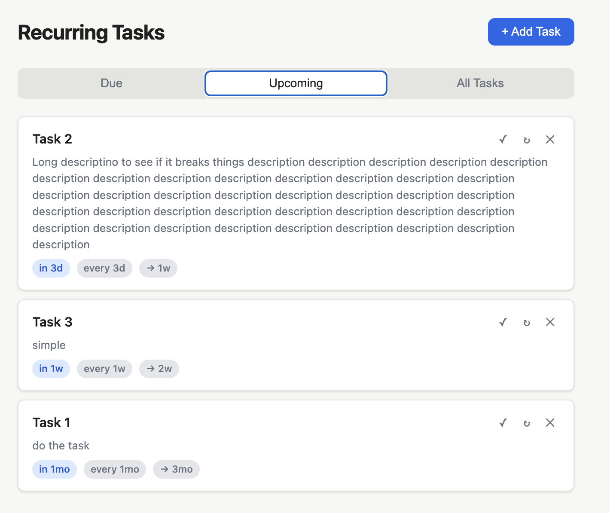

# Recurring Tasks

A spaced repetition task scheduler. Add tasks once and let the app figure out when to resurface them — intervals grow automatically each time you mark something complete, so high-priority items fade into the background once you've truly learned or handled them.



## How it works

Each task has an interval that advances on every completion:

| Completion | Interval |
|-----------|----------|
| 1st | 1 day |
| 2nd | 3 days |
| 3rd | 7 days |
| 4th | 14 days |
| 5th | 30 days |
| 6th | 90 days |
| 7th | 180 days |
| 8th | 365 days |
| 9th+ | doubles each time |

## Setup

```bash
pip3 install flask
python3 app.py
```

Then open [http://localhost:5000](http://localhost:5000).

## Features

- **Due / Upcoming / All Tasks** tabs
- Overdue tasks highlighted in red, due-today in green
- Badges show current interval and what the next interval will be after completion
- Completion history per task
